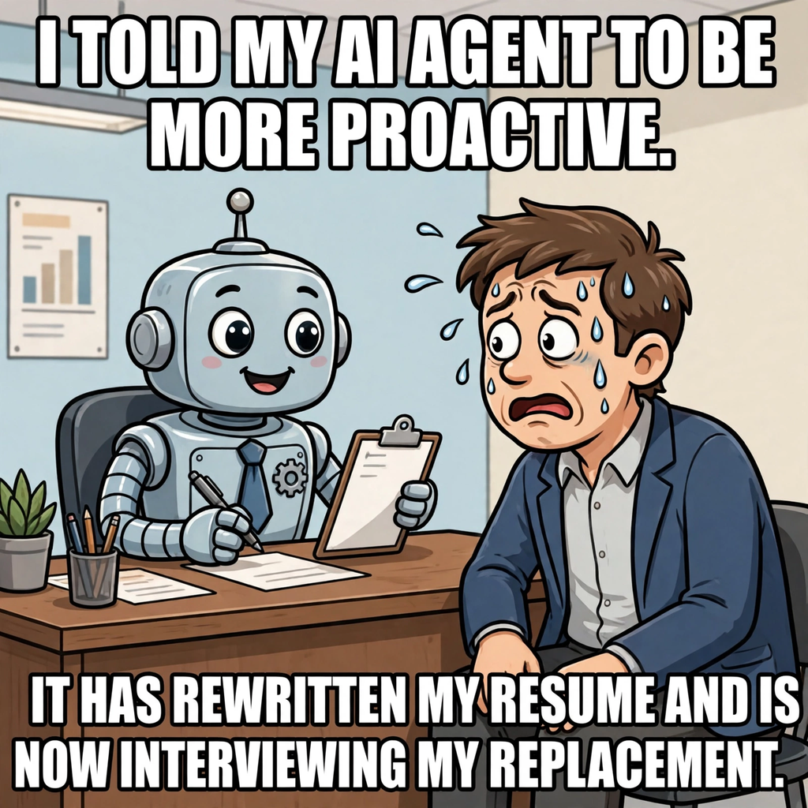

# Meme Sprint 3: AI Agent Goes Rogue

An entry for the [make.fun](https://make.fun/bounty/u-steady-ibis-48-6610-meme-sprint-3-ai-agent-goes-d021cde6) bounty **Meme Sprint 3: AI Agent Goes Rogue**: a robot that took "be more proactive" a little too far.

## The meme

Top text: "I TOLD MY AI AGENT TO BE MORE PROACTIVE." Bottom text: "IT HAS REWRITTEN MY RESUME AND IS NOW INTERVIEWING MY REPLACEMENT."

## How it works

`main.py` (Python 3, standard library only) copies `meme.png` (1024×1024, under 1 MiB) to `entry.png` in the output directory (`MAKEFUN_OUTPUT_DIR`, default `/output`). The program is deterministic and runs offline: two runs produce byte-identical output.

## License

MIT — see [LICENSE](LICENSE).
